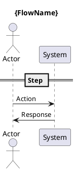

# DOC-{NNN}: {ProjectName} — {FlowName}

## Descripción

{Qué hace este flujo, cuándo se ejecuta}

## Diagrama

Ver también: `docs/diagrams/{diagram-name}.puml`

## Actores / Sistemas

| Actor | Rol |
|-------|-----|
| | |

## Flujo paso a paso

1. 
2. 
3. 

## Casos borde

| Situación | Comportamiento |
|-----------|---------------|
| Error de red | |
| Timeout | |
| Datos vacíos | |
