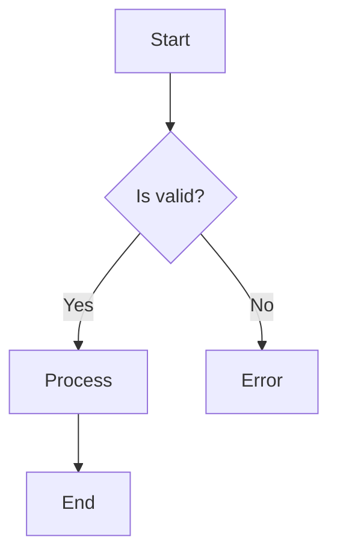
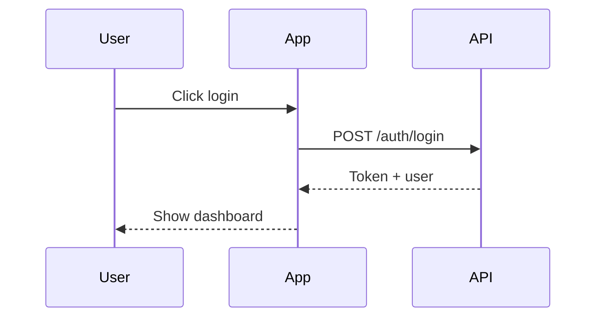
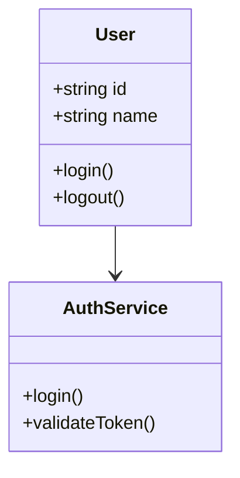

# Obsidian Formatting Reference

## Callouts

```markdown
> [!NOTE] Title
> Content here

> [!TIP] Title
> Pro tip content

> [!WARNING] Title
> Warning content

> [!CAUTION] Title
> Caution content — use sparingly

> [!INFO] Title
> Information callout

> [!EXAMPLE] Title
> Example content
```

## Tables

```markdown
| Feature | Approach A | Approach B |
|---|---|---|
| Speed | Fast | Slow |
| Setup | Complex | Simple |
| Type safety | Full | Partial |
```

## Mermaid Diagrams

### Flowchart



### Sequence Diagram



### Class Diagram



## Embeds

```markdown
![[note-name]]           → Embed full note content
![[image.png]]           → Embed image
         → External image
```

## Wiki-links

```markdown
[[Note Name]]               → Basic link
[[Note Name|Display Text]]  → Link with custom display
[[Note Name#Heading]]       → Link to a heading
[[Note Name#^block-id]]     → Link to a block reference
```

## Code Blocks with Filename

```markdown
```typescript title="src/api.ts"
// code here
```
```

## Tags

```markdown
#react #typescript #concepto

Inline tags: can be placed anywhere in the text #debugging
```

## Dataview Queries

```markdown
```dataview
TABLE tags, estado, fecha
FROM "React"
SORT fecha DESC
```

```dataview
LIST
FROM #concepto AND #react
SORT file.name ASC
```
```

## Frontmatter

```yaml
---
tags: [react, hook, concepto]
fecha: 2026-06-18
estado: borrador
aliases:
  - useState
  - state hook
---
```
