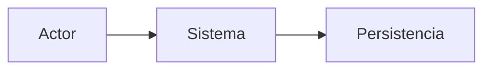

# Documentación humana

Esta skill ayuda a escribir documentación que otro dev pueda usar. No fabrica
un sistema documental si el proyecto no lo necesita.

## Regla principal

El código, los comandos ejecutados y las decisiones aprobadas son evidencia. La
documentación no puede convertir una suposición en un hecho.

- Si se leyó source: citar `Fuente: ruta:línea` o símbolo.
- Si se ejecutó un comando: registrar comando y resultado.
- Si no se verificó: escribir `No verificado`.
- No copiar valores de secretos, tokens, contraseñas o certificados privados.
- No actualizar documentos por “coherencia” sin que el usuario lo pida.

## Categorías

Usar la categoría más pequeña que resuelva el problema:

| Categoría | Sirve para | Puede tomar estos nombres |
|---|---|---|
| Requirements | Qué problema y comportamiento se quiere | BRD, PRD, FRD, FR-NFR |
| Reference | Cómo funciona hoy | TRD, ARCHITECTURE, API, OFFLINE, DESIGN, catálogo |
| Change | Cómo implementar un cambio | TDD, PLAN |
| ADR | Por qué se tomó una decisión durable | ADR, DECISIONS |
| Runbook | Cómo instalar, operar o recuperar | SETUP, RUNBOOK |

La cadena **BRD → PRD → FRD → TRD → TDD → ADR** existe para trabajo formal,
no es un ritual para cada cambio pequeño.

## Cuándo documentar

- Cambio pequeño: actualiza la referencia afectada si hace falta; no crees seis docs.
- Feature o cambio transversal: crea un `Change` y enlaza requisitos solo si existen.
- Cambio difícil de revertir y con alternativas reales: crea un ADR.
- Operación repetible: crea o actualiza un Runbook.
- Producto nuevo o rediseño importante: usa la cadena formal.

## Ubicación y formato

Respeta la convención existente del repositorio. Si usa `docs/DOC-NNN-*`, no la
renombres. Si no existe convención, usa nombres descriptivos:

```text
docs/requirements.md
docs/reference.md
docs/changes/<slug>.md
docs/adr/<slug>.md
docs/runbook.md
```

Frontmatter es opcional. Si existe, no lo reescribas; como mínimo puede contener
`tipo`, `estado`, `verificado_el` y `fuentes`.

## Mermaid

Usa un bloque Mermaid inline cuando explique una relación o flujo:



Un archivo separado solo vale la pena si el diagrama se reutiliza. Un diagrama
debe cubrir un flujo o límite; dividir antes de crear un grafo ilegible.

## Comandos conceptuales

Estos comandos describen operaciones del agente; no implican que exista un CLI.

### `/doc:init [formal]`

1. Leer la convención, README, configuración y docs existentes.
2. Sin `formal`: proponer el documento mínimo que falta; no crear una pirámide.
3. Con `formal`: crear la cadena solicitada en orden, dejando supuestos de negocio visibles.
4. No borrar, renumerar ni reescribir documentos legacy.

Proyecto vacío: crear solo una nota de contexto o Requirements en borrador; no
inventar stack, actores ni métricas.

### `/doc:new <requirements|reference|change|adr|runbook> [título]`

1. Leer los docs relacionados y el source necesario.
2. Usar la estructura mínima de la categoría.
3. Preguntar solo por una decisión humana que bloquee el documento.
4. Citar fuentes concretas y marcar lo no verificado.

Aliases: `BRD`, `PRD`, `FRD`, `TRD`, `TDD`, `ADR`, `SETUP`, `RUNBOOK`, `API`,
`OFFLINE`, `DESIGN` y `ARCHITECTURE` pueden mapear a las categorías anteriores.

### `/doc:check <documento> [fuentes]`

Solo lectura. No es un parser ni un gate automático.

Salida:

```text
CHK-001 | afirmación | ubicación | evidencia observada | coincide/difiere/no evaluado | acción propuesta
```

Debe listar también fuentes no leídas y comandos/tests no ejecutados. No valida
requisitos de negocio contra el código ni afirma que un comando funciona sin correrlo.

### `/doc:apply CHK-001,CHK-002`

Solo después de confirmación explícita de esos IDs. Modifica únicamente los
ítems seleccionados y sus documentos indicados. No tiene `--all`, no actualiza
backlinks, índices, fechas, diagramas ni código por defecto.

### `/doc:sync --check|--apply` y `/doc:audit`

Compatibilidad con la skill anterior:

- `sync --check` y `audit` se comportan como `/doc:check`.
- `sync --apply` se comporta como `/doc:apply` tras confirmación de IDs.
- No decir “clean”, “gate”, “automatizado” o “CI” salvo que exista una herramienta real y se haya ejecutado.

### `/doc:adr "Título"`

Crear un ADR individual solo si la decisión es difícil de revertir, sorprendente
sin contexto y resultado de una alternativa real. Estructura: contexto,
opciones, decisión, consecuencias, reemplaza a y fuentes.

## Plantillas mínimas

### Requirements

Problema/contexto, comportamiento esperado, criterios de aceptación, alcance,
no-alcance, preguntas abiertas y aprobación. BRD/PRD/FRD son niveles de detalle,
no documentos obligatorios adicionales.

### Reference

Alcance, estado actual, interfaces/datos, operación, límites, fuentes y fecha de
revisión. Añadir secciones API, offline, diseño o arquitectura solo si aplican.

### Change

Objetivo, no-objetivo, archivos/componentes, diseño, errores, migración si aplica,
rollback si aplica, pruebas y definición de terminado.

### ADR

Contexto, alternativas, decisión, consecuencias, estado y fuentes. Un archivo
por decisión.

### Runbook

Precondiciones, pasos, cómo comprobar, recuperación, riesgos y secretos por nombre
únicamente.

## Integridad

- Mantener documentos existentes como están hasta que alguien pida migrarlos.
- No inventar números de documento, métricas, endpoints, librerías o estados.
- No convertir un catálogo manual en “generado automáticamente” sin generador.
- No crear diagramas para cumplir una cuota.
- No añadir documentación de framework específica a una skill global: los detalles
  de Expo, HVP, SQLite o una app concreta viven en el proyecto correspondiente.
