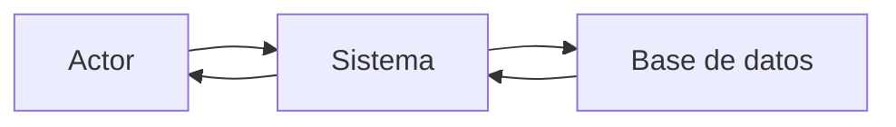

# DOC-{NNN}: {Proyecto} — Flow: {Nombre del Flujo}

## 1. Descripción
Qué hace este flujo, qué lo dispara, qué produce.

## 2. Actores / Sistemas
| Actor/Sistema | Rol | Interfaz |
|---------------|-----|----------|

## 3. Diagrama Mermaid
Ver `docs/diagrams/{nombre-diagrama}.md`

## 4. Flujo Paso a Paso
| Paso | Actor/Sistema | Acción | Validación / Salida |
|------|---------------|--------|---------------------|
| 1 | | | |
| 2 | | | |

## 5. Casos Borde
| Caso | Qué ocurre | Recuperación |
|------|------------|--------------|
| Timeout | | |
| Error red | | |
| Datos inválidos | | |
| Offline | | |
| Conflicto | | |

## 6. Métricas y Observabilidad
| Métrica | Target | Cómo se mide |
|---------|--------|--------------|

---
*Un flujo = un diagrama atómico. Flujos complejos → dividir en múltiples FLOW docs.*