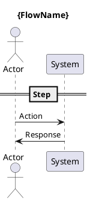

# DOC-{NNN}: {ProjectName} — {FlowName} (LEGACY)

> **Legacy — PlantUML.** Usar `/doc:new FLOW` para nuevos flujos con Mermaid.

## Descripción
{Qué hace este flujo, cuándo se ejecuta}

## Diagrama (PlantUML — legacy)

Ver también: `docs/diagrams/{diagram-name}.puml` (legacy)

## Actores / Sistemas
| Actor | Rol |
|-------|-----|
| | |

## Flujo paso a paso
1. 
2. 
3. 

## Casos borde
| Situación | Comportamiento |
|-----------|---------------|
| Error de red | |
| Timeout | |
| Datos vacíos | |

---
*PlantUML legacy. Migrar a FLOW + Mermaid en `docs/diagrams/{nombre}.md`.*