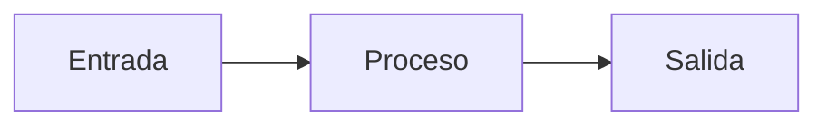

# DOC-{NNN}: {Proyecto} — Technical Design Document: {Título del Cambio}

> Diseño técnico de un cambio concreto. Vinculado a FRD y TRD. Base para implementación y ADRs.

## 1. Contexto y Alcance
- **FRD-IDs afectados:** FR-XXX, FR-YYY
- **TRD secciones afectadas:** 3, 4.1, 7.1
- **Problema a resolver:** Una frase.
- **Alcance del cambio:** Qué entra y qué NO entra.

## 2. Archivos a Tocar
| Archivo | Acción | Responsabilidad | Evidencia actual |
|---------|--------|-----------------|------------------|
| `src/features/.../file.tsx` | crear/modificar/eliminar | | L1-L50 |
| `app/(app)/feature/route.tsx` | crear/modificar | | |

## 3. Diseño Técnico
### 3.1 Interfaces y Data Shapes
```typescript
// Nueva interface / tipo
interface NuevaInterface {
  campo: Tipo;
}
```

### 3.2 Flujo Principal (Mermaid opcional)


### 3.3 Flujo de Errores y Offline
| Escenario | Comportamiento | Evidencia/Validación |
|-----------|----------------|----------------------|
| Sin red | | |
| Timeout API | | |
| DB error | | |
| Datos corruptos | | |

### 3.4 Cambios de Estado (si aplica)
| Estado | Transición | Trigger | Validación |
|--------|------------|---------|------------|

## 4. Migración de Base de Datos (si aplica)
- **Versión destino:** v{N+1}
- **Up:** `CREATE TABLE IF NOT EXISTS` + `ALTER TABLE` guardados
- **Down:** Plan de rollback (¿se puede revertir sin pérdida de datos?)
- **Datos legacy:** Cómo se migran / preservan
- **Idempotencia:** Verificada contra `PRAGMA table_info`

## 5. Rollback Plan
| Paso | Acción | Verificación | Tiempo estimado |
|------|--------|--------------|-----------------|
| 1 | | | |
| 2 | | | |

## 6. Pruebas y Aceptación
### 6.1 Unitarias
| Test | Qué valida | Archivo |
|------|------------|---------|
| | | `tests/...` |

### 6.2 Integración
| Test | Qué valida | Archivo |
|------|------------|---------|

### 6.3 E2E / Manual
| Escenario | Pasos | Resultado esperado |
|-----------|-------|-------------------|

### 6.4 Criterios de Done (verificables)
- [ ] TypeScript compila (`npx tsc --noEmit`)
- [ ] Tests pasan (`npm test` — baseline sin regresiones)
- [ ] Lint/format (si aplica)
- [ ] Mermaid renderiza en GitHub PR
- [ ] No secretos en diff
- [ ] `doc:sync --check` limpio

## 7. Riesgos y Mitigaciones
| Riesgo | Probabilidad | Impacto | Mitigación | Detección temprana |
|--------|--------------|---------|------------|-------------------|

## 8. Decisiones Técnicas (→ ADRs si significativas)
| Decisión | Opción elegida | Alternativa rechazada | ¿Requiere ADR? |
|----------|----------------|----------------------|----------------|

## 9. ponytail: Simplificaciones Deliberadas
| Qué se omitió | Condición para agregar |
|---------------|------------------------|

---
*Este documento guía la implementación. Al completarse, actualizar FRD/TRD y crear ADR si corresponde.*